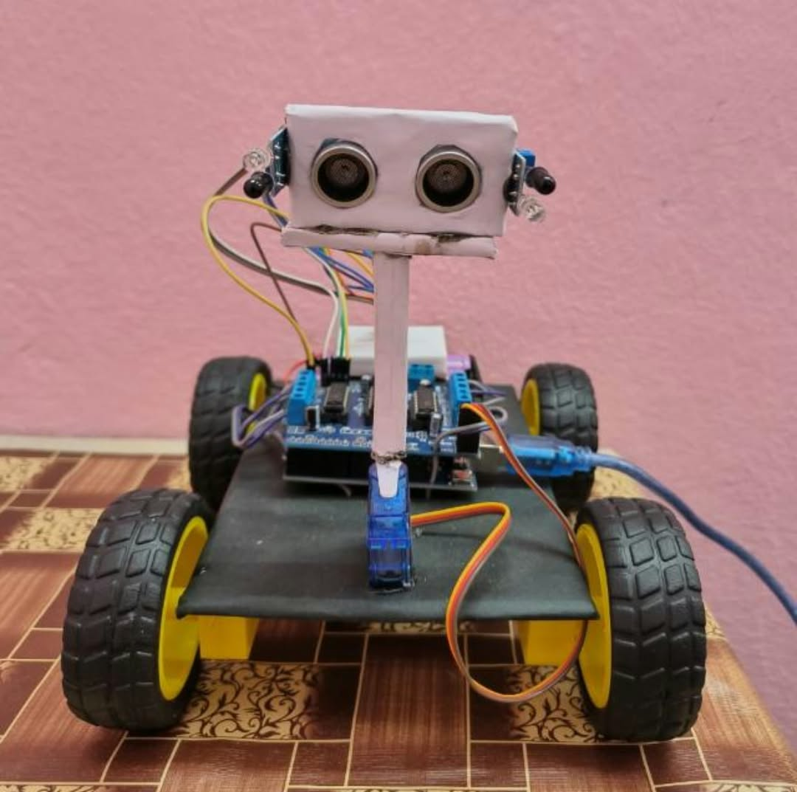

# Human Following Robot 🤖

## Project Overview
The Human Following Robot is an Arduino-based robotics project that automatically detects and follows a human using ultrasonic and IR sensors.

## Hardware Components
- Arduino UNO
- HC-SR04 Ultrasonic Sensor
- L293D Motor Driver Shield
- 2 IR Sensors
- Servo Motor
- 4 DC Geared Motors
- 7.4V–9V Battery
  ## Circuit Diagram

## Technologies Used
- Arduino IDE
- Embedded C/C++
- Ultrasonic Sensing
- Infrared Sensing
- Robotics

## Working Principle
1. The ultrasonic sensor measures the distance of an object.
2. The servo motor helps in scanning different directions.
3. IR sensors detect obstacles or direction.
4. Arduino processes sensor readings.
5. The motor driver controls the four DC motors.
6. The robot moves according to the detected person's position.

## Applications
- Human-following assistance robots
- Smart robotics
- Automated transportation systems

## Author
Rajeev Kumar
## Project Images

### Human Following Robot

